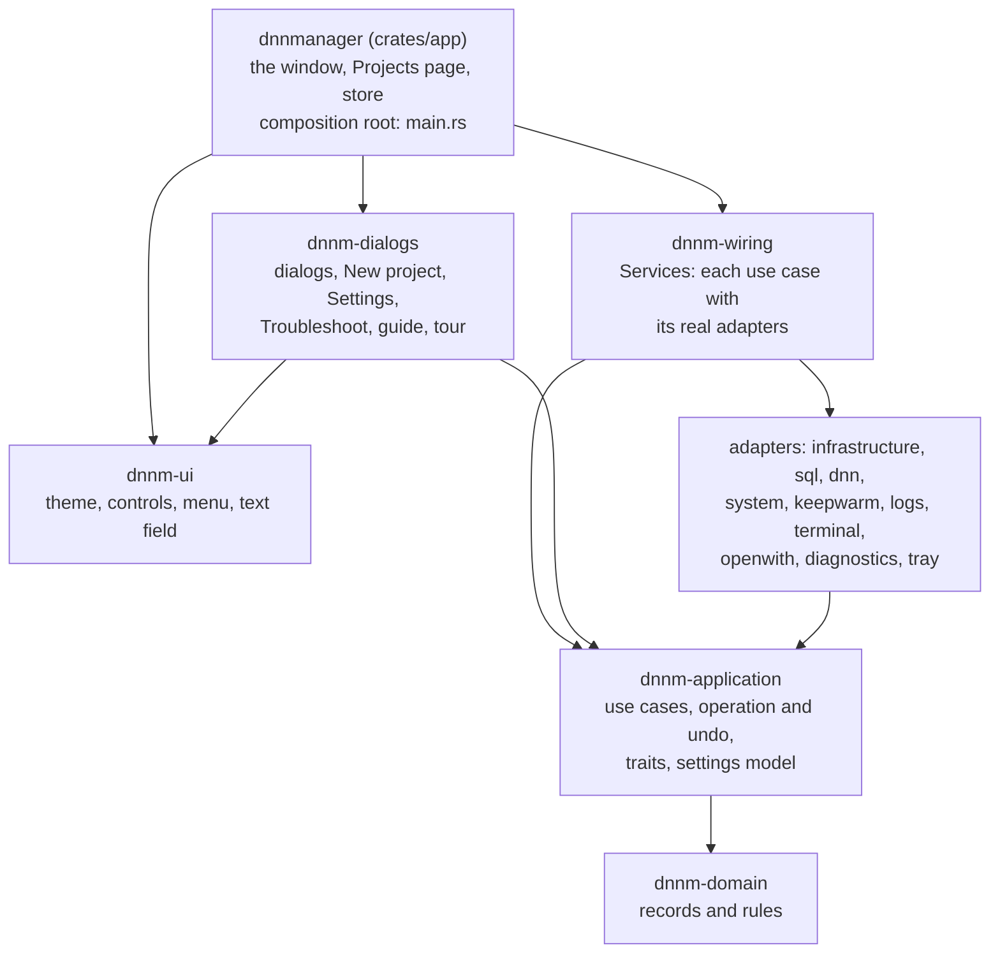
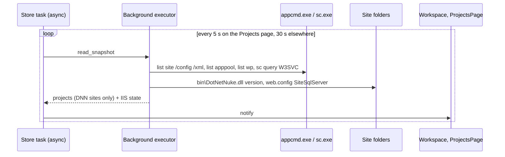

# Architecture

How DNN Manager is built: its crates, how the window stays current, how IIS and SQL Server are reached, the data it
keeps, and the decisions behind them. Setting up and the coding rules: [development.md](development.md).

## Crates and layers

The layers are crate dependencies, so the compiler enforces them:

The use cases (`dnnm-application`) know only traits; `dnnm-wiring` hands each one its real adapters, so the app runs
`wiring::<use case>(&services, request, op)` as an operation. How a use case, its wiring and its dialog are laid out:
[development.md](development.md#where-code-goes).

| Where | What |
|---|---|
| `crates/app/src/main.rs` | Elevation, restart hand-over (`--after`), single instance, number format, the store, the theme, the key bindings, the window |
| `crates/app/src/workspace.rs` | The window: title bar, sidebar, page card, bottom panel, status bar, toasts, dialog host, IIS confirmation |
| `crates/app/src/workspace/` | `commands.rs` (the 78 palette commands), `actions.rs` (a project's edits: dialog, then operation), `modals.rs` (Settings and Troubleshoot over the page), `help.rs` (Help menu, guide, tour, What's new, at the start), `shortcuts.rs` (keyboard shortcuts from the settings), `updates.rs` (Check for Updates), `background.rs` (tray icon, hiding, quitting) |
| `crates/app/src/store.rs` | The live state reads, operations, Output runs, questions, toasts, settings saves |
| `crates/app/src/runner.rs` | An operation on its own thread: lines, facts and questions streamed to the store, Cancel and Stop undoing |
| `crates/app/src/pages/` | `projects.rs` (the table and its menu), `project_view.rs` (Details), `columns.rs` |
| `crates/dialogs/src/` | One file per dialog and page (`setup_page.rs`, `settings_page.rs`, `troubleshoot_page.rs`, `guide.rs`, `tour.rs`, …) |
| `crates/ui/src/` | `theme.rs` (the design tokens - [design-system.md](design-system.md)), controls, `menu.rs`, `dialog.rs`, `text_input.rs` |

## How the window stays current

`Store` is one GPUI entity; every view observes it and re-renders when it changes.

- The status bar's figures are read every 2 s, folder sizes every 60 s and only while the Size column shows.
- Nothing that touches a process, the disk or IIS runs on the UI thread: it runs on GPUI's background executor.
- A read that fails keeps what is shown and sets `Connection::Reconnecting(reason)` - the "Reconnecting…" mark.
- An operation (`Store::run_operation`, `run_changing`, `run_then`) runs on a thread of its own (`runner.rs`). A
  second one while one runs is refused with a toast; its lines go to the Output panel; its questions
  become the window's dialog while the thread waits; a failure or a cancel runs its undo, last step first. A failure
  becomes an error toast with **Show output** (and a Windows notification while the window is hidden), and the
  projects are read again right after.

## IIS

DNN Manager reaches IIS through IIS's own command line, `%windir%\System32\inetsrv\appcmd.exe`, with its `/xml`
output parsed by `roxmltree` - IIS's managed API (Microsoft.Web.Administration) is .NET-only:

| Need | Command |
|---|---|
| Sites, bindings, root app pool, physical path | `appcmd list site /config /xml` |
| App pool states | `appcmd list apppool /xml` |
| Worker process IDs | `appcmd list wp /xml` |
| Start / stop a site (Start starts its pool too) | `appcmd start apppool`, `appcmd start site`, `appcmd stop site` |
| Restart | stop, `appcmd recycle apppool`, start |
| IIS itself | `sc query W3SVC` (state by its number, the same in every language); `iisreset /start`, `/stop`, `/restart` |

Programs are started only from System32, with argument lists (never a shell or a command line built from strings),
without a window and with a time limit (`process::run`): DNN Manager runs elevated, so nothing it starts may be
replaceable by a non-administrator. Reading IIS's configuration needs administrator rights;
appcmd's refusal (exit code 5) is turned into "IIS's configuration can only be read with administrator rights".

## Platforms

DNN Manager's job - IIS - exists only on Windows. The workspace builds on Windows, macOS and Linux (CI checks all
three, and a release packages all three): code that calls Windows APIs is behind `cfg(windows)`, and its other side
says the feature needs Windows. On macOS and Linux the window opens, the Projects page says IIS isn't available on
that system, and what doesn't depend on Windows (settings, release lists, a SQL Server check with a SQL login) works.

## Shared data

DNN Manager keeps its data in `Documents\DnnManager\dnnmanager.db` (`app_db.rs`), the same file and schema as
the earlier C# (WPF) versions, so an installation keeps its settings:

- Settings stay rows of `settings` with the same keys (`appearance.theme`, `appearance.projectColumns[0]`…).
  `Settings` keeps every row, also the ones this build doesn't know, and a save writes only the rows that changed.
- Settings with a higher `version` than 3 were written by a newer DNN Manager: they aren't used or changed.
- A new database gets the five schema steps' tables and `PRAGMA user_version = 5`.
- Each call opens its own short connection with a 5 s busy timeout.

## Decisions and deviations

| Decision | Why |
|---|---|
| Plain `gpui 0.2.2`, own controls | `gpui-component` pins a fork (`gpui-pre`) and brings syntect, LSP types and Markdown; the VS Code look needs a handful of controls of its own anyway. |
| MSVC toolchain pinned in `rust-toolchain.toml` | GPUI supports only MSVC on Windows; its build needs the Windows SDK's `fxc.exe`. |
| appcmd instead of the IIS COM API | No COM interop to maintain for reads; the output is documented XML. IIS writes are appcmd commands too. |
| DNN version from the file version of `bin\DotNetNuke.dll` | Rust can't read a .NET assembly version without a metadata parser; DNN's builds set both versions alike. A hand-built DLL whose versions differ would show its file version. |
| An https binding "has a certificate" when IIS's config notes a `certificateHash` | The certificate bound in http.sys isn't in the config; this only orders which address Open site prefers. |
| Numbers in the user's Windows separators (`locale.rs`) | .NET formats in the current culture: `RAM 25,59 GB` on a Dutch Windows. |
| The fixture refuses what changes things | It points at real site folders and the real `dnnmanager.db`: an operation run there would change them. |
| Check for Updates doesn't install | The release has a package per system (.msi, .dmg, .deb); the user installs the newer one. |
| One version for every crate and the packages | `Cargo.toml`'s `[workspace.package] version` (and `Packager.toml`'s); the release refuses a tag that doesn't match. |
| The table is a set of divs, not a virtualised list | Expanded rows have their own height; a PC has tens of sites, not thousands. |

### By subsystem

Each is also said in a comment where it is made.

| Crate | Decision | Why |
|---|---|---|
| `infrastructure` (IIS) | IIS's configuration is read as raw `applicationHost.config` sections through `appcmd list config`, defaults from `applicationPoolDefaults` then IIS's schema, coded in Rust | No managed IIS API in Rust |
| `infrastructure` (IIS) | Rename is several appcmd commands - a failure part way leaves a partial rename, which the use case's undo puts back | appcmd commits one change per command |
| `infrastructure` (IIS) | A binding kept by Edit host names is removed and added in the same `set site` - the order of bindings may change | appcmd's collection syntax |
| `infrastructure` (IIS) | App pool profiles are removed with `DeleteProfileW`, not PowerShell's `Win32_UserProfile` | No PowerShell needed |
| `sql` | No connection pooling; on Windows TLS through schannel and Windows authentication, elsewhere rustls and SQL logins only; a named instance without a port is reached over TCP through SQL Browser (`.\SQLEXPRESS` needs TCP enabled); shared memory (`lpc:`) is refused with a message | tiberius speaks TDS over TCP and named pipes; no OpenSSL to install on Linux |
| `sql` | LocalDB through its instance API's named pipe (`SqlUserInstance.dll`, `LocalDBStartInstance`), Windows authentication, without TLS; a LocalDB file is attached with `CREATE DATABASE … FOR ATTACH` | tiberius has no `AttachDbFilename`; LocalDB closes the pipe on TLS |
| `sql` | A cancel or a time-out drops the connection instead of sending an attention; BACKUP's "10 percent processed" lines aren't shown | tiberius doesn't expose either |
| `sql` | SqlPackage gets the password on its command line (masked in messages) | It has no other way - the one exception to "no passwords in command lines" |
| `dnn` | Download redirects followed by hand, at most 10, each https or loopback | Downloads run elevated: no plain-http hop |
| `dnn` | web.config edits with the `xot` crate: an empty element is written `<x/>`; web.config gets a link check before it is written | The link rule ([development.md](development.md#rules)) |
| `dnn` | Windows events for the upgrade checks from `wevtutil qe … /f:RenderedXml` | No event log API in the crates used |
| `logs` | Event logs are polled (entries newer than the newest seen), not pushed; Find uses Rust's `regex` (no backtracking: no look-around or back-references); the daily file refuses to write through a link | No push API for the event log in Rust; `regex` is linear-time |
| `keepwarm` | The app feeds complete reads of the sites, not the monitor's events; HTTPS to the site with the binding's host as SNI, no certificate check (as .NET with SNI from Host) | One source of truth: the store's reads |
| `system` | ACLs as SDDL through `GetNamedSecurityInfoW`; generic rights count as "can change" in the trust check - a little stricter | SDDL is one string to compare and log |
| `system` | IIS feature names reach PowerShell as checked, quoted literals in the script text; docker and winget run with DNN Manager's environment | `process::run` takes no environment |
| `terminal` | Shells are ended with a kill-on-close job object; rename is a small inline editor without IME; one shell glyph for all | Job objects end the whole tree; GPUI has no text box with IME here |
| `app` | Keyboard shortcuts: every binding is made again on save; a changed command's default is taken away with `NoAction` in the context it was bound in, its new keys run `RunCommand { id }` | GPUI's keymap has no per-command rebinding |
| `app` | Quitting while an operation runs waits for its undo | Nothing is left half done |
| `app` | The tray hides the window with `ShowWindow(SW_HIDE)` on the GPUI window's HWND | GPUI has no hide |
| `ui` | Esc empties only search boxes; in every other field it closes what the field is in | A dialog closes on Esc as people expect |
| `dialogs` | The tour's dimmed area is four rectangles (square corners round the part); the tray uses Windows' own menu | GPUI has no clip paths |
| `dialogs` | Settings → Repositories is one field per URL; UI scale is saved but not applied | No multi-line text box; GPUI has no zoom |

