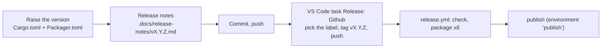

# Releasing

A release is built and published by GitHub from a version tag - nothing built on a PC is uploaded.



## Steps

1. **Raise the version** in `Cargo.toml` (`[workspace.package] version`) and `Packager.toml` (`version`). The release
   workflow refuses a tag that doesn't match `Cargo.toml`.
2. **Write the notes**: `.docs/release-notes/vX.Y.Z.md` (the `release-notes` skill knows the structure). The workflow
   publishes it as the release's notes, and the app shows it under **What's new** - it is built in. Without the file
   GitHub writes notes from the commits.
3. **Commit and push**, and wait for CI (`.github/workflows/ci.yml`) to pass on that commit.
4. **Run the VS Code task Release: Github** (`scripts/release.ps1`). It asks for the release's label - **Latest**
   (what DNN Manager's update check finds), **Pre-release** or **None** - checks the working tree is clean, shows the
   tag and asks, then pushes the branch and the tag `vX.Y.Z`. The label travels in the tag's message
   (`Release-Label: latest`), which the workflow reads. `-Suffix rc1` makes `vX.Y.Z-rc1`.
5. **Follow the run** on GitHub (Actions → Release). The `publish` job runs in the environment `publish`: give that
   environment a required reviewer in the repository's settings and every release waits for approval.

## What the workflow makes

`.github/workflows/release.yml`, on a pushed tag `vX.Y.Z` or `vX.Y.Z-*`:

| Job | Runner | Output |
|---|---|---|
| check | ubuntu-24.04 | the tag matches `Cargo.toml` |
| windows-x86_64 | windows-2025 | `DnnManager-windows-x86_64.msi` |
| windows-arm64 | windows-11-arm | `DnnManager-windows-arm64.msi` |
| macos-arm64 | macos-14 | `DnnManager-macos-arm64.dmg` |
| macos-x86_64 | macos-14 (cross-built) | `DnnManager-macos-x86_64.dmg` |
| linux-amd64 | ubuntu-22.04 | `DnnManager-linux-amd64.deb` |
| linux-arm64 | ubuntu-22.04-arm | `DnnManager-linux-arm64.deb` |
| publish | ubuntu-24.04 | the two .debs again as `-x86_64.deb` and `-aarch64.deb`, `SHA256SUMS.txt`, the GitHub release with the tag's label (without one: Latest, or a pre-release for a tag with a suffix) |

Each package job builds `cargo build --release -p dnnmanager --target <triple>`, copies the exe into `dist/` and
packages it with
[cargo-packager](https://github.com/crabnebula-dev/cargo-packager) (version pinned in the workflow) from
`Packager.toml`: WiX for the .msi, a disk image for the .dmg, a Debian package for the .deb (its run-time libraries
listed under `[deb] depends`). The Linux jobs install GPUI's build dependencies with `scripts/linux-deps.sh`; Ubuntu
22.04 keeps the .deb working on older glibc.

The packages are **not code-signed**. Signing needs a certificate (Windows) and an Apple Developer ID (macOS) stored
as repository secrets - not set up.

## A build on this PC

The VS Code task **Publish** (`scripts/publish.ps1`) asks **executable** or **installer**, then which systems -
several at once (the multi-select picker comes from the extension **Tasks Shell Input**,
`augustocdias.tasks-shell-input`, which the workspace recommends; the list, with its icons, is written in `.vscode/tasks.json`, input `publishPlatforms`):

| Pick | Into `dist\` |
|---|---|
| executable | `DnnManager-windows-x86_64.exe`, `DnnManager-linux-amd64`, … (Linux also as `linux-x86_64` / `linux-aarch64`, the release's other names) |
| installer | the executable and its `.msi` / `.dmg` / `.deb`, e.g. `DnnManager-windows-x86_64.msi` |

A PC compiles for its own operating system only: Windows for `windows-x86_64` and `windows-arm64` (that one needs
Visual Studio's *MSVC ARM64 build tools*), a Mac for both macOS builds, Linux for Linux. Systems picked that this PC
can't build are skipped with a note - the release on GitHub builds all of them. Without the task (no
`-Platform`: it lists the systems in the terminal and asks):

```powershell
powershell -File scripts/publish.ps1 -Kind installer -Platform windows-x86_64,windows-arm64
```

## A package on this PC

The VS Code task **Package** builds this system's package into `dist\`:

```powershell
cargo install cargo-packager --locked          # once
cargo build --release -p dnnmanager
mkdir dist; copy target\release\DnnManager.exe dist\        # cargo-packager takes the exe from its output folder
cargo packager --release --formats wix --out-dir dist         # .msi; --formats dmg / deb on macOS / Linux
```

It was tried on Windows: `dist\DnnManager_1.8.7_x64_en-US.msi` (about 12 MB), which installs `DnnManager.exe` into
`Program Files\DNN Manager`.

## Release a version again

The tag exists but its run failed, or one more change is wanted - and nobody has the release yet (`gh release view
vX.Y.Z` finds none published). Commit and push the change, then run `scripts/release.ps1 -Redo`: it moves the tag to
the new commit and pushes it again. A published release is never redone - DNN Manager offers only newer versions; raise
the version instead.

## Updates inside the app

**Check for Updates** asks GitHub for the newest release and says whether there is a newer one
([`updates.rs`](../crates/app/src/workspace/updates.rs)). Installing it is done by downloading the package from the
release page.
