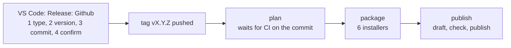

# Releasing

A release is packaged and published by GitHub from a version tag - nothing built on a PC is uploaded. CI is the test:
the release waits for CI on the tagged commit and publishes nothing unless it passed. Nothing is tested twice.



## Steps

1. **Release notes** (optional): `.docs/release-notes/vX.Y.Z.md`, committed and pushed (the `release-notes` skill
   knows the structure). The release gets it as its notes and the app shows it under **What's new**; without it GitHub
   writes notes from the commits.
2. **Run the VS Code task Release: Github** (Ctrl+Shift+B). Four pickers, each filled by `scripts/release.ps1`:

   | Picker | What it offers |
   |---|---|
   | 1/4 Release type | **Latest** (what DNN Manager's update check finds), **Pre-release**, **None** |
   | 2/4 Version | The versions whose notes are in `.docs/release-notes/` and that have no published release yet, of the type picked (`v2.0.0-rc2.md` → 2.0.0-rc2). Nothing else is guessed: without notes for that type it says so - write the notes first. Any other version can be typed. |
   | 3/4 Commit | The newest 30 commits on the branch's remote - a release is made from a pushed commit only; a released one says so |
   | 4/4 Confirm | The release spelled out (version, type, commit, notes) - or, when something is wrong, only *Can't release* with the reason |

   It refuses - before anything is pushed - a version that isn't newer than the newest release, a version that is published already, a
   pre-release without a suffix (`-rc1`) or a Latest with one, a commit that isn't on the remote, and a commit whose CI
   failed, was cancelled or never ran (the confirmation says whether CI passed or is still running). On **Release** it
   checks all of that again, tags the commit (an annotated tag whose message carries `Release-Label: <type>`) and
   pushes only the tag.
3. **Follow the run** on GitHub (Actions → Release). The `publish` job runs in the environment `publish`: give that
   environment a required reviewer in the repository's settings and every release waits for approval.

The version isn't kept in the repository: the tag is the version. The workflow writes it into `Cargo.toml`,
`Cargo.lock` and `Packager.toml` before building (`scripts/set-version.py`; `Packager.toml` gets the plain X.Y.Z, as an
MSI's version is numbers only). The `1.8.7` in `Cargo.toml` is only what a local build says.

## What the workflow does

`.github/workflows/release.yml`, on a pushed tag `vX.Y.Z` or `vX.Y.Z-suffix`:

| Job | Runs on | What it does - a failure stops everything after it |
|---|---|---|
| plan | ubuntu-24.04 | The tag is a version; the release type from the tag's message (a tag without one: Latest, or a pre-release with a suffix); type and suffix agree; the tag isn't published already. Then it waits (up to an hour) for **CI** (`ci.yml`: build, clippy and every test on Windows, Linux and macOS, warnings as errors) on the tagged commit, and stops when CI failed, was cancelled or never ran. |
| package | one runner per installer | Writes the version in, builds clean (`-D warnings`), packages with cargo-packager, checks the file is there and not empty. Only the installer leaves the job. |
| publish | ubuntu-24.04, environment `publish` | Checks the files are exactly the six installers (never an executable), adds the .debs as `-x86_64.deb` / `-aarch64.deb` and `SHA256SUMS.txt`, uploads everything to a **draft**, checks every file arrived, then publishes it with its type. A failure deletes the draft - no release is left half made. |

| Installer | Runner |
|---|---|
| `DnnManager-windows-x86_64.msi` | windows-2025 |
| `DnnManager-windows-arm64.msi` | windows-11-arm |
| `DnnManager-macos-arm64.dmg` | macos-15 |
| `DnnManager-macos-x86_64.dmg` | macos-15 (cross-built) |
| `DnnManager-linux-amd64.deb` (also `-x86_64.deb`) | ubuntu-22.04 |
| `DnnManager-linux-arm64.deb` (also `-aarch64.deb`) | ubuntu-22.04-arm |

[cargo-packager](https://github.com/crabnebula-dev/cargo-packager) (version pinned in the workflow) makes them from
`Packager.toml`: WiX for the .msi, a disk image for the .dmg, a Debian package for the .deb (its run-time libraries
listed under `[deb] depends`). The Linux jobs install GPUI's build dependencies with `scripts/linux-deps.sh`; Ubuntu
22.04 keeps the .deb working on older systems.

The ARM64 .msi needs two things cargo-packager doesn't have on its own: WiX 3.14 (it downloads 3.11, which has no
ARM64) and a template that knows ARM64 (`assets/wix/main.wxs`, its own with an `arm64` branch and Windows Installer
5.0, set as `[wix] template`). The workflow's step "WiX 3.14" puts WiX 3.14.1 (its hash pinned) in
`%LOCALAPPDATA%\.cargo-packager\WixTools`, where cargo-packager uses it instead of downloading. To build
`windows-arm64` on a PC, unzip `wix314-binaries.zip` from WiX's 3.14.1 release there first. When the packager's version
changes, compare its `src/package/wix/main.wxs` with ours.

The installers are **not code-signed**. Signing needs a certificate (Windows) and an Apple Developer ID (macOS) stored
as repository secrets - not set up.

The macOS app is **signed ad hoc** (no certificate) by the release step "Ad-hoc sign the app": it copies the `.dmg`'s
contents out, runs `codesign --force --deep --sign -` on the app, checks it with `codesign --verify --deep --strict`
and makes the `.dmg` again under the same volume name. Without it, a Mac that downloads the app says it "is damaged
and can't be opened"; with it, macOS says Apple can't check it and **System Settings → Privacy & Security → Open
Anyway** opens it. Gatekeeper still warns until the app is signed with a Developer ID and notarized. cargo-packager's
own signing (`signing-identity = "-"`) isn't used: it always adds `--timestamp` and the hardened runtime.

## A build on this PC

The VS Code task **Publish** (`scripts/publish.ps1`) asks **executable** or **installer**, then which systems -
several at once (the multi-select picker comes from the extension **Tasks Shell Input**,
`augustocdias.tasks-shell-input`, which the workspace recommends; the list, with its icons, is written in `.vscode/tasks.json`, input `publishPlatforms`):

| Pick | Into `dist\` |
|---|---|
| executable | `DnnManager-windows-x86_64.exe`, `DnnManager-linux-amd64`, … (Linux also as `linux-x86_64` / `linux-aarch64`, the release's other names) |
| installer | the executable and its `.msi` / `.dmg` / `.deb`, e.g. `DnnManager-windows-x86_64.msi` |

Every build uses `-D warnings`, so a warning stops it. A PC compiles for its own operating system
only: Windows for `windows-x86_64` and `windows-arm64` (that one needs
Visual Studio's *MSVC ARM64 build tools*), a Mac for both macOS builds, Linux for Linux. Systems picked that this PC
can't build are skipped with a note - the release on GitHub builds all of them. Without the task (no
`-Platform`: it lists the systems in the terminal and asks):

```powershell
powershell -File scripts/publish.ps1 -Kind installer -Platform windows-x86_64,windows-arm64
```

An installer needs cargo-packager once: `cargo install cargo-packager --locked`. It takes the executable from its
output folder, so the script copies it there first. Tried on Windows: `dist\DnnManager-windows-x86_64.msi` (about
12 MB), which installs `DnnManager.exe` into `Program Files\DNN Manager`.

## Release a version again

Only a published GitHub release counts as released. When a tag's run failed or was cancelled, nothing was published
and the version is free again: fix it, push the fix, and run **Release: Github** with the same version and the new
commit - the picker still offers it, and the release moves the tag to that commit. A published release is never
redone: the picker refuses it, so release the next version instead.

## Updates inside the app

**Check for Updates** asks GitHub for the newest release and says whether there is a newer one
([`updates.rs`](../crates/app/src/workspace/updates.rs)). Installing it is done by downloading the package from the
release page.
